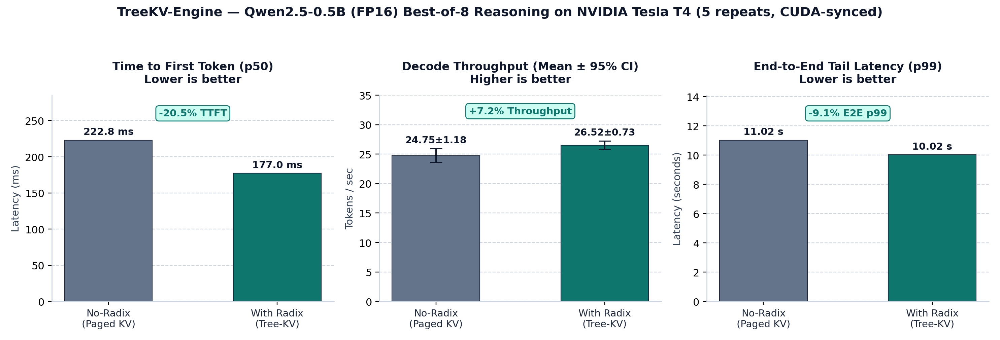

# BanyanKV

[](https://github.com/swayamsaini/banyankv/actions)

A small LLM inference engine written from scratch in pure PyTorch for `Qwen/Qwen2.5-0.5B`.

Live visualizer for the block allocator and T4 runs: https://swayamsaini.github.io/banyankv/

## Why I wrote this

I wanted to understand how serving engines like vLLM and SGLang actually manage KV memory under the hood, instead of just calling `model.generate()`. So I wrote a minimal version myself in ~1,500 lines of PyTorch: a scratch Qwen2.5 decoder, 16-token paged KV cache with copy-on-write, continuous batching, a radix prefix tree for Best-of-N prompts, and speculative decoding.

Named it **BanyanKV** after the banyan tree, since a single shared prompt prefix branches out into multiple independent reasoning trajectories without duplicating the root KV blocks.

I built and ran the unit tests on my Windows laptop (Ryzen 5 5600H, no local GPU) and ran the Hugging Face parity check and FP16 benchmarks on free Kaggle Tesla T4 notebooks. This is a reference implementation in plain PyTorch, not a vLLM replacement (there are no custom Triton/CUDA kernels yet).

## What is implemented

- **Decoder (`treekv/model/`)**: Scratch `Qwen2.5-0.5B` forward pass with RMSNorm, RoPE (`theta=1e6`), 7:1 GQA (14 Q heads, 2 KV heads), SwiGLU, tied embeddings, and a weight loader from Hugging Face `transformers`.
- **Paged KV cache (`treekv/memory/block_manager.py`)**: Fixed 16-token blocks (`192 KB` per block in FP16 across 24 layers), a free-list `BlockAllocator`, reference counting, and copy-on-write when a branch diverges on a shared block.
- **Radix prefix tree (`treekv/memory/radix_cache.py`)**: Chained block-hash prefix cache with LRU eviction on unlocked leaves (`lock_count == 0`). Also includes a `NullPrefixCache` adapter so radix sharing can be toggled off cleanly for ablations.
- **Scheduler (`treekv/engine/scheduler.py`)**: Iteration-level continuous batching with prefill-first scheduling and LIFO recompute preemption when the block pool runs dry.
- **Speculative decoding (`treekv/engine/speculative.py`)**: Standard rejection sampling (`min(1, p/q)` and residual resampling from `norm(max(0, p - q))`), cross-boundary KV block rollback, a simple prompt-lookup n-gram drafter, and batch-size gating (`adaptive_gamma`).
- **Benchmarking (`treekv/bench/`)**: `torch.cuda.synchronize()` timing, deterministic Poisson arrival traces, p50/p99 latency, and 95% Student-t confidence intervals.

## Benchmarks (Kaggle Tesla T4)

Run details: `Qwen/Qwen2.5-0.5B` in FP16 on a single NVIDIA Tesla T4 (`15,360 MiB`, PyTorch `2.11.0+cu130`, transformers `5.20.2`), Best-of-8 parallel branches, `max_new_tokens=32`, 5 repeats.



| Metric (Best-of-8, 5 repeats) | No-Radix | With Radix (BanyanKV) | Diff |
|---|---:|---:|---:|
| TTFT p50 | 222.80 ms | 177.02 ms | -20.55% |
| Throughput (mean +/- 95% CI) | 24.75 +/- 1.18 tok/s | 26.52 +/- 0.73 tok/s | +7.15% |
| End-to-end p99 | 11,019.32 ms | 10,020.75 ms | -9.06% |

The prompt in this run is fairly short (~56 tokens), so decode still dominates total wall time. Even there, sharing the prompt blocks cuts median TTFT by ~20.6% and brings p99 down by ~1 second. On longer shared prompts (512+ tokens), the prefill savings grow linearly with prompt length. Raw JSON output is saved in [`results/study_summary.json`](results/study_summary.json).

All 12 tests (including the token-for-token check against Hugging Face `Qwen/Qwen2.5-0.5B`) pass on Kaggle T4 in `40.60s`.

## Notes and bugs I ran into

- **Qwen2 projection biases**: Unlike Llama, Qwen2/Qwen2.5 uses `bias=True` on `q_proj`, `k_proj`, and `v_proj`, and `bias=False` on `o_proj` and the MLP layers. Missing those biases doesn't throw a shape error; the logits just quietly diverge. Having `test_exact_match_vs_huggingface_qwen2_5` caught this immediately.
- **KV rollback across block boundaries**: In speculative decoding, if a rejected draft crosses a 16-token block boundary, just shortening `seq_len` leaks the newly allocated physical block. `rollback_kv()` recalculates the surviving block count and frees the extra blocks back to the allocator (`test_cross_boundary_kv_rollback_zero_leaks`).
- **Why decode is ~26 tok/s**: Right now the decode loop runs in plain Python/PyTorch without a fused paged-attention kernel, so kernel launch overhead caps throughput. Writing a batched Triton kernel is the main thing I want to try next.

## Running locally

The offline test suite (11 tests) runs on CPU in ~11 seconds without downloading model weights:

```bash
git clone https://github.com/swayamsaini/banyankv.git
cd banyankv
python -m venv .venv
# Windows: .venv\Scripts\activate | Linux/macOS: source .venv/bin/activate
pip install -e ".[dev]"
ruff check configs/ treekv/ tests/
PYTHONPATH=. pytest -v tests/ -k "not huggingface_qwen2_5"
```

To run the full Hugging Face parity test and the T4 benchmark on Kaggle, import [`notebooks/kaggle_t4_runner.ipynb`](notebooks/kaggle_t4_runner.ipynb) with Accelerator set to `GPU T4 x2` and Internet turned on, or run directly on a CUDA machine:

```bash
pytest -v tests/
python -m treekv.bench.run_study --model Qwen/Qwen2.5-0.5B --n-branches 8 --max-new-tokens 32 --repeats 5 --out results/
```

## References

- Kwon et al., *Efficient Memory Management for Large Language Model Serving with PagedAttention* (vLLM, SOSP 2023): https://arxiv.org/abs/2309.06180
- Yu et al., *Orca: A Distributed Serving System for Transformer-Based Generative Models* (OSDI 2022): https://www.usenix.org/conference/osdi22/presentation/yu
- Zheng et al., *SGLang: Efficient Execution of Structured Language Model Programs* (2024): https://arxiv.org/abs/2312.07104
- Leviathan et al., *Fast Inference from Transformers via Speculative Decoding* (ICML 2023): https://arxiv.org/abs/2211.17192

## License

MIT
